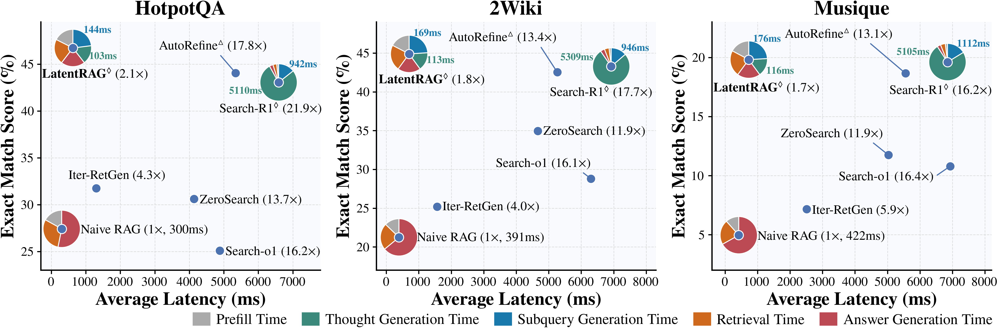

<!-- # LatentRAG: Latent Reasoning and Retrieval for Efficient Agentic RAG -->

<h1 align="center">
  <picture title="The blue-to-green gradient represents the continuous latent thought tokens (blue) and latent subquery tokens (green) in the LatentRAG framework.">
  </picture>: Latent Reasoning and Retrieval for Efficient Agentic RAG
</h1>

<p align="center">
  <a href="https://arxiv.org/abs/2605.06285"></a>
  <a href="https://github.com/zhengyijia/LatentRAG"></a>
  <a href="https://huggingface.co/collections/zhengyijia142/latentrag-models"></a>
</p>

<p align="center">
  <strong>Yijia Zheng, Marcel Worring</strong>
  <br>
  University of Amsterdam
</p>

## Overview

This repo provides the official implementation for the NeurIPS 2026 paper "[LatentRAG: Latent Reasoning and Retrieval for Efficient Agentic RAG](https://arxiv.org/abs/2605.06285)". LatentRAG is an efficient agentic RAG framework that shifts both reasoning and retrieval from discrete language space to continuous latent space, enabling end-to-end joint optimization of the LLM and the retrieval model while reducing overall latency by approximately 90%.

<p align="center">
  <picture>
  
  </picture>
  <br />
  <sub><span style="color: #888888;">Performance and latency comparison across multi-hop QA datasets. LatentRAG achieves comparable performance to competitive agentic RAG methods such as Search-R1 and AutoRefine, while maintaining efficiency on par with naive single-step RAG.</span></sub>
</p>

## Environment Setup

The code has been tested with Python 3.10 and CUDA 12.8. To set up the environment, run the following commands:

```shell
conda create -n latent_rag_env python=3.10
conda activate latent_rag_env
bash install.sh
```

## Training and Evaluation

Below are the training and evaluation scripts for running our model with the Qwen3-Embedding-0.6B retrieval model, covering the full pipeline from data preparation to training and evaluation. All commands should be executed from the root directory of this project.

### (1) Download datasets

Download the Wikipedia 2018 corpus and the QA datasets

```shell
cd scripts/preprocessing
bash download_corpus.sh
bash download_qa_data.sh
```

The corpus will be stored in `data/corpus`, and the QA datasets will be stored in `data/qa_data`.

### (2) Build retrieval index

```shell
cd scripts/preprocessing
bash build_corpus_index.sh
# will build index for Qwen3-Embedding-0.6B
# change the commented code in `build_corpus_index.sh` to build index for other retrieval models
```

The built index files will be stored in `data/corpus/wiki18_100w_qwen3-embedding-0.6b_fp16_shard`.

For quick reproduction, we provide the precomputed indices on [Hugging Face](https://huggingface.co/collections/zhengyijia142/latentrag-corpus-index). You can download the indices constructed with `Qwen3-Embedding-0.6B` using the following command:

```shell
huggingface-cli download zhengyijia142/wiki18_100w_qwen3-embedding-0.6b_fp16_shard \
    --repo-type dataset \
    --local-dir data/corpus/wiki18_100w_qwen3-embedding-0.6b_fp16_shard
```

### (3) Launch retrieval server

```shell
cd scripts/launch_retriever_server
bash launch_qwen3-embedding-0.6b.sh
# bash launch_{RETRIEVAL_MODEL_NAME}.sh
# change the `RETRIEVAL_MODEL_NAME` to run with other retrieval models
```

### (4) Construct training trajectories

Search-R1 (7B):
```shell
cd scripts/preprocessing/gen_reasoning_steps
bash gen_searchr1_steps_qwen2.5-7b-em-ppo_qwen3-embedding-0.6b.sh
# bash gen_searchr1_steps_qwen2.5-7b-em-ppo_{RETRIEVAL_MODEL_NAME}.sh
# change the `RETRIEVAL_MODEL_NAME` to run with other retrieval models
```

AutoRefine (7B)
```shell
cd scripts/preprocessing/gen_reasoning_steps
bash gen_autorefine_steps_qwen2.5-7b_qwen3-embedding-0.6b.sh
# e.g., bash gen_autorefine_steps_qwen2.5-7b_{RETRIEVAL_MODEL_NAME}.sh
# change the `RETRIEVAL_MODEL_NAME` to run with other retrieval models
```

The constructed training trajectories will be stored in `data/reasoning_steps`. If the retrieval server in step (3) is running on a different machine, please update `retriever.base_url` in the script accordingly.

**The scripts are configured by default to run on two 94 GB GPUs.** If you use a different GPU configuration and encounter CUDA OOM errors, add a custom vLLM configuration under `config/gpu_env` and update `GPU_ENV_CONFIG` in the corresponding scripts.

For quick reproduction, we provide the constructed trajectories generated by Search-R1 (7B) and AutoRefine (7B) on [Hugging Face](https://huggingface.co/collections/zhengyijia142/latentrag-training-trajectories). You can download training trajectories constructed with `Qwen3-Embedding-0.6B` using the following command:

```shell
huggingface-cli download zhengyijia142/SearchR1_AutoRefine_reasoning_steps_qwen3-embedding-0.6b \
    --repo-type dataset \
    --local-dir data/reasoning_steps
```

### (5) Training Model

The training code has been tested on two H100 GPUs, each with 94 GB of memory. For other hardware configurations, please modify `GPU_ENV_CONFIG` in the training script and add the corresponding configuration file under `config/gpu_env/latentrag_qwen2.5-7b-base_qwen3-embedding-0.6b` to ensure proper adaptation to GPU memory constraints.

LatentRAG (based on Search-R1 trajectories)
```shell
cd scripts/training
bash train_latentrag_qwen2.5-7b-base_qwen3-embedding-0.6b_search-r1_qwen2.5-7b.sh
# bash train_latentrag_qwen2.5-7b-base_{RETRIEVAL_MODEL_NAME}_search-r1_qwen2.5-7b.sh
# change the `RETRIEVAL_MODEL_NAME` to run with other retrieval models
```

LatentRAG (based on AutoRefine trajectories)
```shell
cd scripts/training
bash train_latentrag_qwen2.5-7b-base_qwen3-embedding-0.6b_autorefine_qwen2.5-7b-base.sh
# bash train_latentrag_qwen2.5-7b-base_{RETRIEVAL_MODEL_NAME}_autorefine_qwen2.5-7b-base.sh
# change the `RETRIEVAL_MODEL_NAME` to run with other retrieval models
```

The trained model weights will be stored in `trainer_output`.

### (6) Evaluation

### Evaluation using your saved model weights

Please set `LORA_PATH` in the corresponding evaluation script to the path of the model weights directory saved in the previous step.

LatentRAG (based on Search-R1 trajectories)
```shell
cd scripts/evaluation_based_on_reasoning_steps
bash eval_latentrag_qwen2.5-7b-base_qwen3-embedding-0.6b_search-r1_qwen2.5-7b.sh
# bash eval_latentrag_qwen2.5-7b-base_{RETRIEVAL_MODEL_NAME}_search-r1_qwen2.5-7b.sh
# change the `RETRIEVAL_MODEL_NAME` to run with other retrieval models
```

LatentRAG (based on AutoRefine trajectories)
```shell
cd scripts/evaluation_based_on_reasoning_steps
bash eval_latentrag_qwen2.5-7b-base_qwen3-embedding-0.6b_autorefine_qwen2.5-7b-base.sh
# bash eval_latentrag_qwen2.5-7b-base_{RETRIEVAL_MODEL_NAME}_autorefine_qwen2.5-7b-base.sh
# change the `RETRIEVAL_MODEL_NAME` to run with other retrieval models
```

### Evaluation with our Hugging Face checkpoints

For quick reproduction, we provide our model checkpoints on [Hugging Face](https://huggingface.co/collections/zhengyijia142/latentrag-models). You can download using the following command:

```shell
# LatentRAG (based on Search-R1 trajectories)
huggingface-cli download zhengyijia142/LatentRAG_Qwen2.5-7B_qwen3-embedding-0.6b_Search-R1_Qwen2.5-7B \
    --local-dir trainer_output/LatentRAG_Qwen2.5-7B_qwen3-embedding-0.6b_Search-R1_Qwen2.5-7B
```

Then in the evaluation script, set `LORA_PATH` to `trainer_output/LatentRAG_Qwen2.5-7B_qwen3-embedding-0.6b_Search-R1_Qwen2.5-7B` and run the evaluation script: 

```shell
cd scripts/evaluation_based_on_reasoning_steps
bash eval_latentrag_qwen2.5-7b-base_qwen3-embedding-0.6b_search-r1_qwen2.5-7b.sh
```

## Acknowledgements

This work uses datasets from [FlashRAG](https://github.com/RUC-NLPIR/FlashRAG), [InfoSeek](https://huggingface.co/datasets/Lk123/InfoSeek), and [BrowseComp-Plus](https://github.com/texttron/BrowseComp-Plus). We use [Search-R1](https://github.com/PeterGriffinJin/Search-R1), [AutoRefine](https://github.com/syr-cn/AutoRefine), and [AgentCPM](https://github.com/OpenBMB/AgentCPM) to construct trajectories for supervised fine-tuning. The codebase also contains implementations of several baseline methods, including [IRCoT](https://github.com/StonyBrookNLP/ircot), [Iter-RetGen](https://arxiv.org/abs/2305.15294), [Search-o1](https://github.com/RUC-NLPIR/Search-o1), [R1-Searcher](https://github.com/RUCAIBox/R1-Searcher), [ZeroSearch](https://github.com/Alibaba-nlp/ZeroSearch), and [DeepRAG](https://github.com/gxy-gxy/DeepRAG). We thank the authors and contributors of these datasets and methods. 

## Citation

```
@inproceedings{zheng2026latentrag,
  title={LatentRAG: Latent Reasoning and Retrieval for Efficient Agentic RAG},
  author={Yijia Zheng and Marcel Worring},
  booktitle={NeurIPS},
  year={2026}
}
```

## License

This repository, as well as the finetuned model weights on [Hugging Face](https://huggingface.co/collections/zhengyijia142/latentrag-models), are released under the [MIT License](LICENSE).

